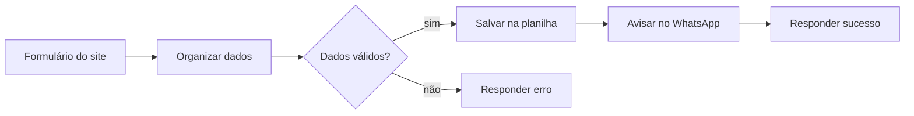

# ⚙️ Automações com n8n — FL Conecta Digital

Automações prontas para **pequenos negócios** economizarem tempo e não perderem clientes.
Criadas com [n8n](https://n8n.io), rodando em servidor próprio (VPS).

> Os fluxos deste repositório são **modelos de demonstração**: não contêm dados, chaves ou contatos de clientes reais.

---

## 📥 Captura de leads do site → Planilha + aviso no WhatsApp

**O problema:** o cliente preenche o formulário do site, mas o contato fica perdido no e-mail ou ninguém responde a tempo.

**A solução:** assim que alguém preenche o formulário, o n8n:

1. **Recebe** os dados do site (nome, WhatsApp, cidade e necessidade)
2. **Organiza e valida** as informações (limpa o número, confere se tem DDD)
3. **Salva** o contato numa planilha do Google, com data e hora
4. **Avisa o dono do negócio no WhatsApp** na mesma hora
5. **Responde ao site** com uma mensagem de confirmação para o visitante



**Resultado para o negócio:** nenhum contato se perde, a resposta ao cliente fica muito mais rápida e todos os leads ficam organizados numa planilha.

📄 Arquivo: [`workflows/captura-leads-whatsapp.json`](workflows/captura-leads-whatsapp.json)

---

## 🚀 Como usar

### 1. Importar o fluxo
No n8n, clique em **Workflows → Import from File** e escolha o arquivo `.json`.

### 2. Configurar a planilha
- Crie uma planilha no Google com uma aba chamada **Leads** e as colunas:
  `nome` · `whatsapp` · `cidade` · `necessidade` · `recebido_em`
- No nó **Salvar na planilha**, conecte sua conta Google e troque `COLE_AQUI_O_ID_DA_SUA_PLANILHA` pelo ID da planilha (o trecho do link entre `/d/` e `/edit`).

### 3. Configurar o WhatsApp
O aviso usa uma API de WhatsApp compatível com a [Evolution API](https://doc.evolution-api.com). Defina estas variáveis de ambiente no n8n:

| Variável | Exemplo | Para que serve |
| --- | --- | --- |
| `WHATSAPP_API_URL` | `https://api.seudominio.com.br` | Endereço da sua API de WhatsApp |
| `WHATSAPP_INSTANCIA` | `minha-empresa` | Nome da instância conectada |
| `WHATSAPP_API_KEY` | *(sua chave)* | Chave de acesso da API |
| `WHATSAPP_DONO` | `5519999999999` | Número que recebe o aviso |

> 🔒 Nunca coloque chaves direto no fluxo. Use variáveis de ambiente ou credenciais do n8n.

### 4. Ligar no site
Ative o fluxo e envie os dados do formulário para a URL do webhook:

```js
fetch("https://SEU-N8N/webhook/novo-lead", {
  method: "POST",
  headers: { "Content-Type": "application/json" },
  body: JSON.stringify({ nome, whatsapp, cidade, necessidade }),
});
```

Para testar pelo terminal:

```bash
curl -X POST https://SEU-N8N/webhook/novo-lead \
  -H "Content-Type: application/json" \
  -d '{"nome":"Maria","whatsapp":"(19) 99999-9999","cidade":"Itirapina","necessidade":"Site"}'
```

---

## 🛠️ Tecnologias

`n8n` · `Webhooks` · `Google Sheets API` · `WhatsApp API` · `JavaScript` · `VPS`

---

## 💼 Precisa de uma automação para o seu negócio?

Faço automações sob medida: atendimento no WhatsApp, agendamentos, cadastro de clientes, avisos automáticos e integrações entre sistemas.

- 🌐 [FL Conecta Digital](https://flconectadigital.com.br)
- 💼 [LinkedIn](https://www.linkedin.com/in/fabricio-costa-b71b293a9)
- 🐙 [GitHub](https://github.com/fabriciocostacp-svg)
